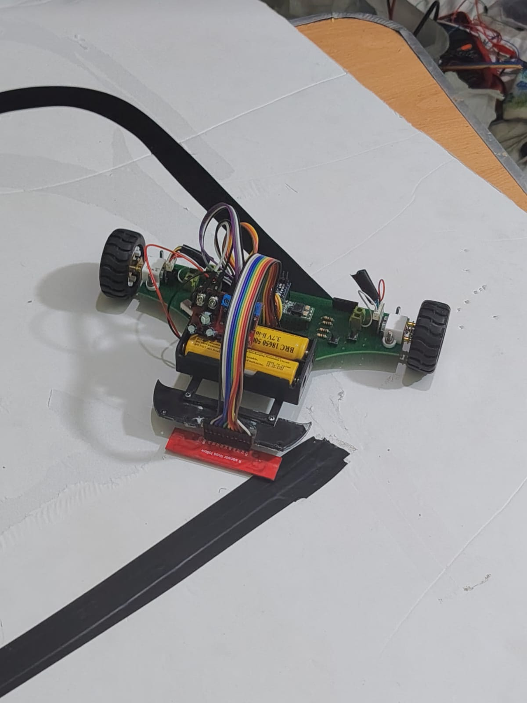
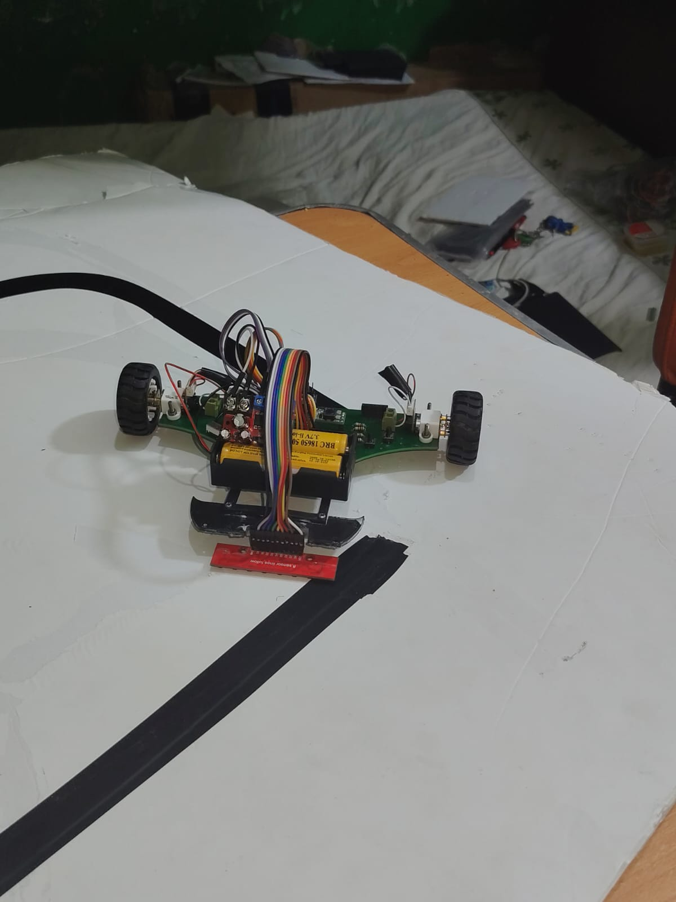
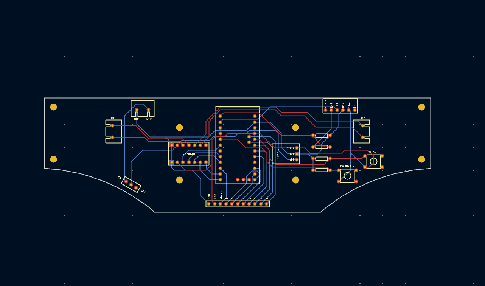
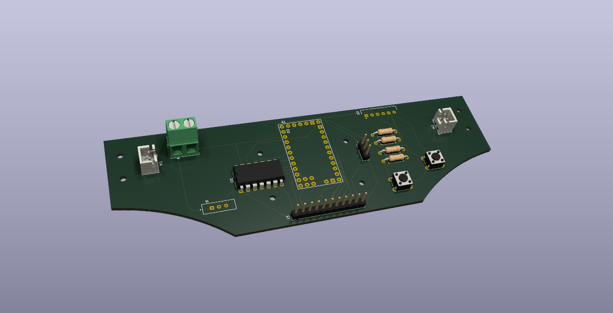
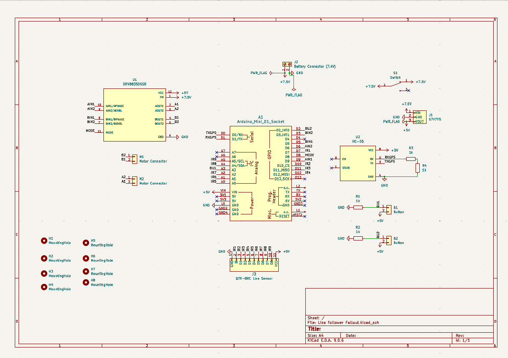
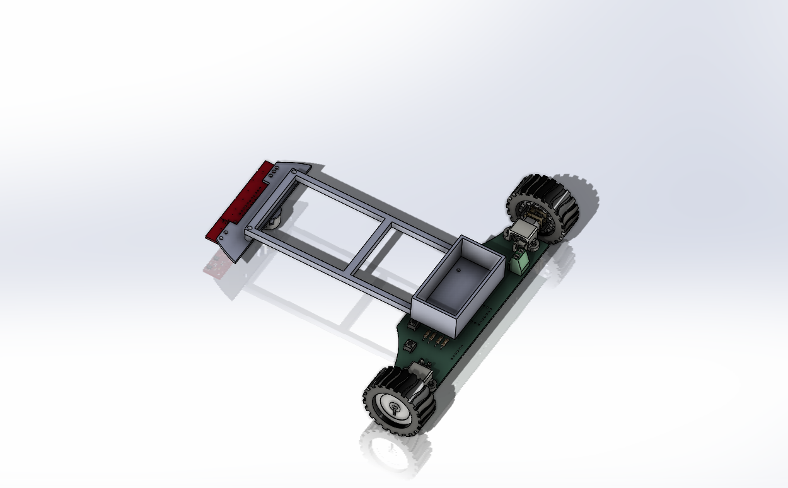
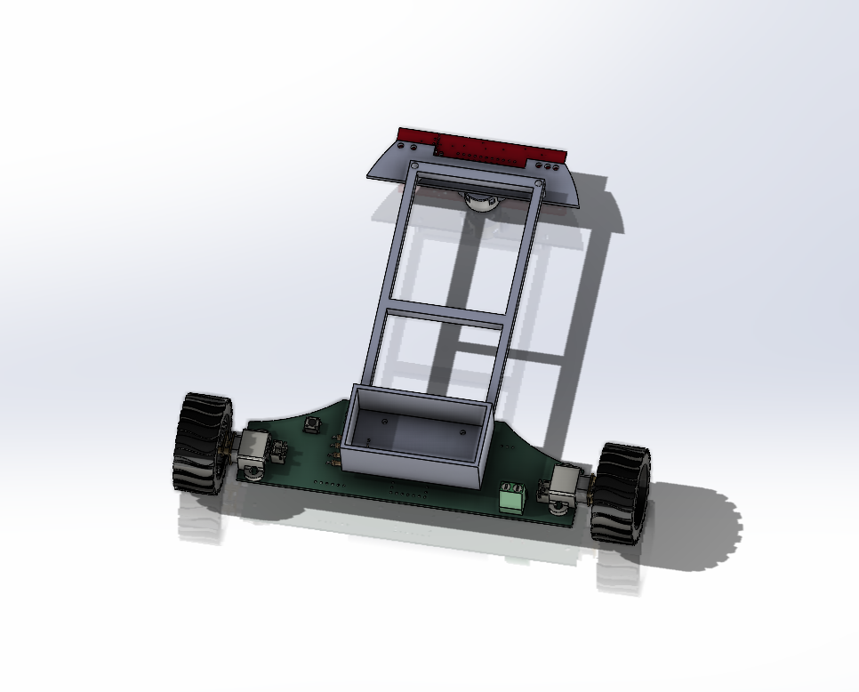

# Line Follower Bot

This is my competition line follower. Our team won first place in the seniors line follower category at TechnoXian Egypt and qualified for the World Cup in Malaysia. I worked on the custom PCB, mechanical design, assembly, and tuning.

## What I wanted to learn

I wanted to understand PID control properly, so I researched existing line followers and built my own version around an Arduino Pro Mini and a QTR-8RC sensor array.

The robot uses the sensor array to read the line and adjust the two motors. I also added an HC-05 Bluetooth module so I could change tuning values without uploading the code again every time.

## Hardware

- Arduino Pro Mini
- QTR-8RC eight-channel reflectance sensor array
- Dual motor driver, listed as DRV8835 in the original design notes
- HC-05 Bluetooth module
- 7.4 V battery and 5 V regulator
- Power switch and buttons
- Custom PCB and printed chassis, sensor mount, and battery support

The original parts list names a DRV8835, but its supplier link points to a DRV8833. Check the circuit files and the board you're using before treating that link as an exact replacement.

## How the build went

I started with the schematic, then moved to the PCB. There were footprint issues to fix before routing, and I added mounting holes so the board could screw into the body.

I designed the chassis around the electronics, keeping the sensor low and aligned with the ground and giving the battery its own support. Before the PCB arrived, I tested the controller, Bluetooth connection, motor directions, sensor channels, and regulator on a breadboard. That caught some wiring mistakes early.

Once the board arrived, I soldered it, checked for bridges and wrong orientations, and checked power and ground with a multimeter before powering it up.

## CAD

## Tuning and demo

The values recorded in my build notes were `Kp = 0.02`, `Ki = 0`, and `Kd = 0.6`. Those belong to this setup and aren't universal settings for another robot.

[Watch the S-shaped track demo](https://youtu.be/TAyl4BceC5A) or open the [uploaded video](Demo%20video.mp4).

The sketch currently uploaded in `Firmware/` is a motor direction test. Despite its filename, it isn't the full PID or Bluetooth tuning firmware.

## Parts list

These are the original component estimates and supplier links. They aren't current prices or a complete cost for the whole robot.

|Component                                          |Store                |Qty|Unit Price (EGP)|Total (EGP)                    |Total (USD approx)|Link                                                                                                                                     |
|---------------------------------------------------|---------------------|---|----------------|-------------------------------|------------------|-----------------------------------------------------------------------------------------------------------------------------------------|
|Arduino Pro Mini 328 5V/16MHz                      |RAM Electronics      |1  |250             |250                            |4.98              |https://www.ram-e-shop.com/shop/arduino-mini-pro-arduino-pro-mini-328-5v-16mhz-7180                                                      |
|DRV8835 Dual Motor Driver                          |Makers Electronics   |1  |180             |180                            |3.59              |https://makerselectronics.com/product/drv8833-2-channel-dc-motor-driver/?srsltid=AfmBOopl0AXVi_7erC0TRuiovgie-HcAb31S7vhGDk1mQixUt8-UI5Q2|
|QTR-8RC 8 Channel Line Sensor Array                |Micro Ohm Electronics|1  |135             |135                            |2.69              |https://microohm-eg.com/qtr-8rc-8-channel-line-tracker-reflectance-sensor-array/                                                         |
|HC-05 Bluetooth Module (6 pin)                     |RAM Electronics      |1  |200             |200                            |3.98              |https://www.ram-e-shop.com/shop/kit-bluetooth-hc05-normal-hc-05-bluetooth-module-normal-6674                                             |
|7.4V Li-ion Battery Pack 2S-1P 1000mAh w/ BMS + JST|Makers Electronics   |1  |210             |210                            |4.18              |https://makerselectronics.com/product/rechargeable-li-ion-battery-pack-7-4v-2s-1pbms-1000mah-18650-with-jst-cable/                       |
|L7805CV Voltage Regulator 5V/1A TO-220             |Micro Ohm Electronics|1  |6               |6                              |0.12              |https://microohm-eg.com/product/7805-regulator-ic/                                                                                       |
|DPDT Slide Power Switch (ON/ON 6 pin)              |Micro Ohm Electronics|1  |10              |10                             |0.2               |https://microohm-eg.com/on-on-switch-6-pin-pcb-mounted-22mm-dpdt-slide-switch/                                                           |
|Tactile Push Button 12x12x12mm                     |Micro Ohm Electronics|1  |3.5             |3.5                            |0.07              |https://microohm-eg.com/press-12x12x12mm-push-button-switch-4-pin/                                                                       |
|TOTAL                                              |                     |   |                |994.50 (incl. DRV8835 estimate)|19.81             |                                                                                                                                         |

## Zine

[Open the PDF](Magazine/Magazine%20of%20Line%20follower%20bot.pdf).

## Files

- [CAD](CAD/) — assembly and STEP model
- [Individual SolidWorks parts](3D%20model%20source/)
- [Schematic, PCB, and Gerbers](Schematic%20and%20PCB/)
- [Motor test sketch](Firmware/Final_code_i_hope.ino)
- [BOM](BOM.csv)
- [Build journal](line-follower-bot-journal.md)

I'm also planning a new standalone ATmega328P design: [Line-E](https://github.com/ZIZO932/Line-E).

Made by Ziad, or Zizo if you know me from Hack Club.
